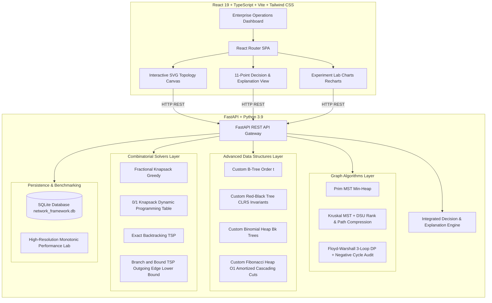

# Adaptive Network Design and Optimization Framework: System Architecture

## 1. System Overview

The **Adaptive Network Design and Optimization Framework** is an end-to-end full-stack software application engineered for Design and Analysis of Algorithms (DAA) Course Project 4. It models, analyzes, indexes, and optimizes metropolitan and enterprise computer networks by unifying graph theory, advanced tree structures, priority heaps, dynamic programming, and combinatorial search into a single explainable framework.

---

## 2. Architecture Diagram

---

## 3. Layered Design Breakdown

### 3.1 Presentation Layer (Frontend)
- **React 19 & TypeScript:** Type-safe components consuming strongly typed API schemas.
- **Tailwind CSS:** Professional enterprise technology styling with deep navy (`#0F172A`), blue (`#2563EB`), and teal (`#0D9488`) accents.
- **Interactive SVG Canvas (`NetworkGraph`):** Renders draggable network vertices, edge weight badges, and dynamic highlights for MST edges, shortest-path chains, and TSP tours.
- **Recharts Data Visualization:** Renders empirical performance curves, comparison bar charts, and theoretical complexity reference baselines.

### 3.2 Service & Decision Layer (Backend)
- **FastAPI Framework:** High-performance asynchronous REST endpoints with automatic OpenAPI documentation.
- **Integrated Decision & Explanation Engine:** Evaluates graph density, resource divisibility, and operation scale to provide structured 11-point explanations for every algorithm execution.
- **Pydantic Validation:** Validates request parameters, array shapes, budget bounds, and input types.

### 3.3 Algorithmic Core
All algorithms and data structures are implemented from first principles in pure Python:
1. **Module 1 (MST):** Prim's algorithm using binary min-heap and Kruskal's algorithm with Disjoint-Set Union (DSU) featuring path compression and union by rank.
2. **Module 2 (All-Pairs Delays):** Canonical three-loop Floyd-Warshall DP recurrence with predecessor matrix path reconstruction and negative cycle detection.
3. **Module 3 (Hardware Records):** Custom B-Tree parameterized by degree $t$ (node splitting, borrowing, merging, deletion) and CLRS Red-Black Tree (rotations, recoloring, deletion fixup).
4. **Module 4 (Emergency Tickets):** Binomial Heap ($B_k$ linked root trees) and Fibonacci Heap (circular doubly linked lists, $O(1)$ amortized decrease-key with cascading cuts).
5. **Module 5 (Budget Upgrades):** Fractional Knapsack greedy ratio sorting and 0/1 Knapsack dynamic programming table.
6. **Module 6 (Inspection Routes):** Exact permutation backtracking and Branch & Bound with minimum outgoing edge lower bounding.

### 3.4 Data Persistence & Benchmarking Layer
- **SQLite Database:** Stores topological vertices, weighted links, hardware device records, maintenance tickets, upgrade projects, and past experiment records.
- **High-Resolution Timer (`time.perf_counter_ns()`):** Monotonic microsecond clock measuring real wall-clock latency across multiple trials with median filtering.
